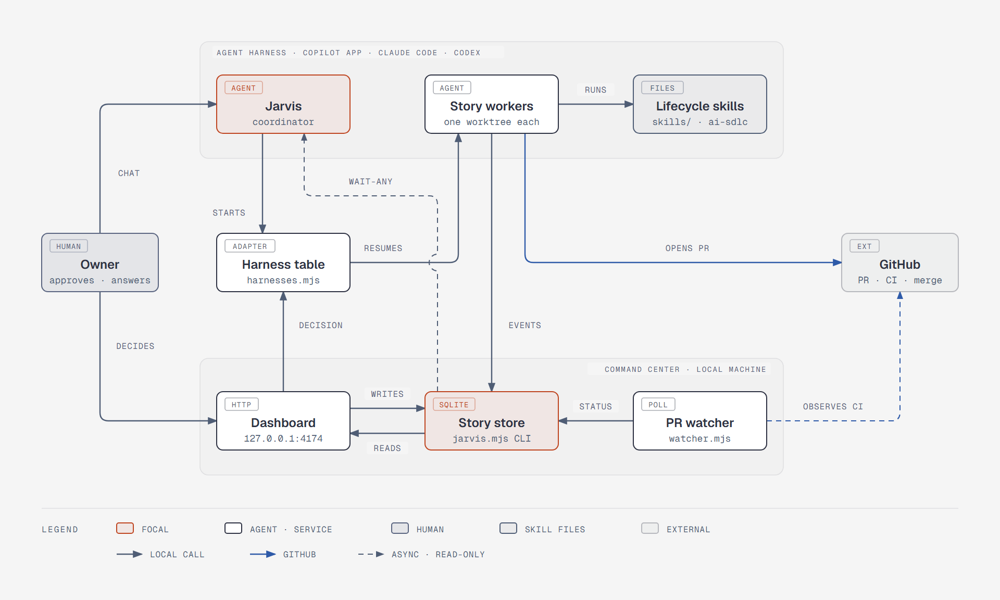
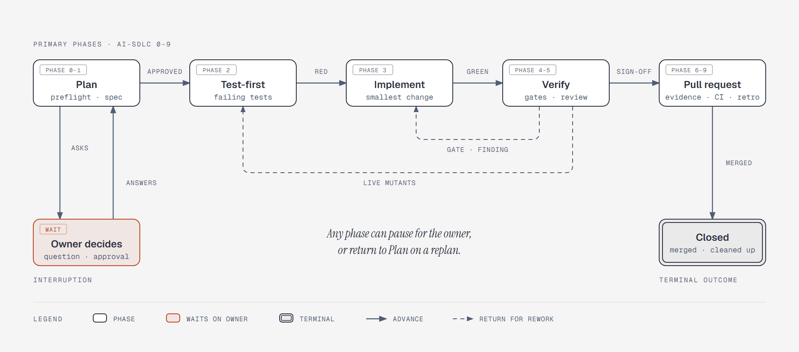

# Software Factory

[](https://github.com/Ramanathan10/software-factory/actions/workflows/test.yml) [](LICENSE)

Everything needed to run the AI software development lifecycle from one clone: the skills that define the lifecycle and the Command Center application that coordinates and observes it.

## See it work

[](docs/software-factory-demo.mp4)

The GIF links to the full-resolution MP4.

## Architecture

Start at the owner. The owner talks to Jarvis in the harness chat and makes every decision in the Command Center dashboard. The dashboard, the supervisor, the story store and the PR watcher run as one local process, the factory daemon. Jarvis asks the supervisor to start a story's worker; the supervisor starts it through the harness table, hands it the owner's decisions, and records when each of its turns starts and ends. The worker runs the lifecycle skills in its own worktree and records each step in the story store. Jarvis does no phase work: it asks for workers and hears about their progress from the store.



### Story lifecycle

Each story moves through the `ai-sdlc` phases in order. The ten phases are grouped into five here; the phase numbers on each box match the `ai-sdlc` skill.



The diagrams are drawn in `docs/architecture.html` and `docs/lifecycle.html`. Edit those, then export the PNGs again with the `diagram-design` skill.

## Contents

| Path | What it is |
|---|---|
| `skills/` | The lifecycle skills (below). |
| [`mission-console/`](mission-console/README.md) | Story store (SQLite), event rules, `jarvis.mjs` CLI, PR watcher, and the original standalone dashboard. Works from any agent harness. |
| `command-center/` | The factory daemon: one local process that serves the dashboard, starts each story's worker and watches its turns (`supervisor.mjs`), and observes registered pull requests. The dashboard UI: stories, questions, plan approval with comments, evidence, attachments. Shows the number of stories waiting on the owner in its tab title and, once allowed, as desktop notifications. Harness-neutral; wakes the coordinator through an `onDecision` callback. `serve.mjs` runs it on its own, `serve.mjs start <story>` starts a story's worker, and `serve.mjs deliver <story>` hands a story's waiting decisions to its worker when the owner decided in chat. |
| `adapters/harnesses.mjs` | The one table of harnesses: how each is installed and how its story workers are started and messaged. The [factory runbook](skills/jarvis/RUNBOOK.md) describes its use. |
| `adapters/copilot/extension.mjs` | Hosts the Command Center inside the GitHub Copilot app, the one harness that only runs code as an extension. |
| `readiness-sync/` | Optional read-only check that a story is finished in the team's work tracker. `trackers.mjs` is the one table of trackers (Azure DevOps, GitHub, Linear); it never writes to any of them. |
| `install.mjs` | Installs the skills into every harness in the table, and reports what is installed. |

## Skills

| Skill | Role in the factory |
|---|---|
| `ai-sdlc` | The lifecycle: preflight, plan, test-first, implement, required gates, review, pull request, retro. |
| `ai-sdlc-setup` | One-time interview per machine and per repository; saves the profile and provides the preflight check. |
| `jarvis` | Coordinator: delegates stories to workers and mirrors `ai-sdlc` phases into the Command Center. |
| `grill-me` | Plan interview. |
| `ponytail` | Smallest complete implementation. |
| `adversarial-code-review` | Cross-model code review with unanimous sign-off. |
| `before-and-after` | Matched before-and-after evidence of a visible change. |
| `diagram-design` | Architecture diagrams for pull request descriptions. |
| `greploop` | Iterating on Greptile review feedback. |
| `learnings`, `self-improvement` | The retro: lessons for the target repository and for the workflow. |
| `explainer`, `hyperframes` | Explanations in the right format, including video. |

When the `ai-sdlc` phases change, update `mission-console/roles.mjs`, the store's transitions, and the phase table in `skills/jarvis/SKILL.md` in the same change.

## Run and test

Node 24 or later (Node 22 needs `--experimental-sqlite`). No package installation.

```powershell
node --test
node ./mission-console/jarvis.mjs demo
node ./command-center/serve.mjs
```

`serve.mjs` runs the Command Center at `http://127.0.0.1:4174/` (pass another port as its argument). Starting it twice reports the one already running.

## Install

One command installs every harness, on any operating system:

```powershell
node install.mjs
```

It sets up each harness it finds on the machine; name one (`codex`, `claude-code`, `cursor`, `copilot`) to set it up anyway. `node install.mjs --check` reports what is installed without changing anything.

| Harness | How it is installed |
|---|---|
| Codex, Claude Code, Cursor | One link per skill, so they read the skills in place. A skill of the same name that is already there is left alone and reported as blocked, and the installer exits with an error, because the harness would use that one and not this repository's. `node install.mjs --replace` moves each blocking skill aside to `<name>.bak-<time>` and installs this one; nothing is deleted. If the harness's skills folder is itself a single link to another repository, the installer says so and leaves it alone. |
| GitHub Copilot app | Copies, because the app does not follow links: the skills and the Command Center extension go under `~\.copilot`. Anything replaced is moved to a `.bak-<time>` folder beside it, and an existing `diagram-design` is kept. Run the installer again after updating this repository. |

Then restart the harness and say "Be Jarvis. Run AI SDLC." in a repository that has an `origin` remote; a story ends in a pull request, so one that has not been pushed anywhere is refused. The first run asks the `ai-sdlc-setup` questions once and saves the profile; later runs ask only for an answer the profile lacks.

## State and the profile

- Stories, shared by every project: `AI_SDLC_CONSOLE_DB` when set; otherwise an existing `~\.copilot\ai-sdlc-console\jarvis-missions.sqlite`; otherwise `console\jarvis-missions.sqlite` in the AI SDLC home (`AI_SDLC_HOME`, default `~\.ai-sdlc`).
- Everything about how a person works: one file, `profile.json` in the AI SDLC home, written by the `ai-sdlc-setup` skill. It holds the owner, sharing rules, implementation level, review round limit, before-and-after and diagram settings, worker permissions, the model each harness runs for each tier of work, each repository's gates, branch pattern, worktree folder, team rules and work tracker, where the Command Center is, and a section for any adapter that needs its own answers. It is each person's own; nothing is written into the repository a story runs in.

## Contributing

Issues and pull requests are welcome; see [CONTRIBUTING.md](CONTRIBUTING.md) and the [code of conduct](CODE_OF_CONDUCT.md). Report security problems privately as [SECURITY.md](SECURITY.md) describes.

## License

MIT; see [LICENSE](LICENSE). Imported skills keep their own license file in their folder.
